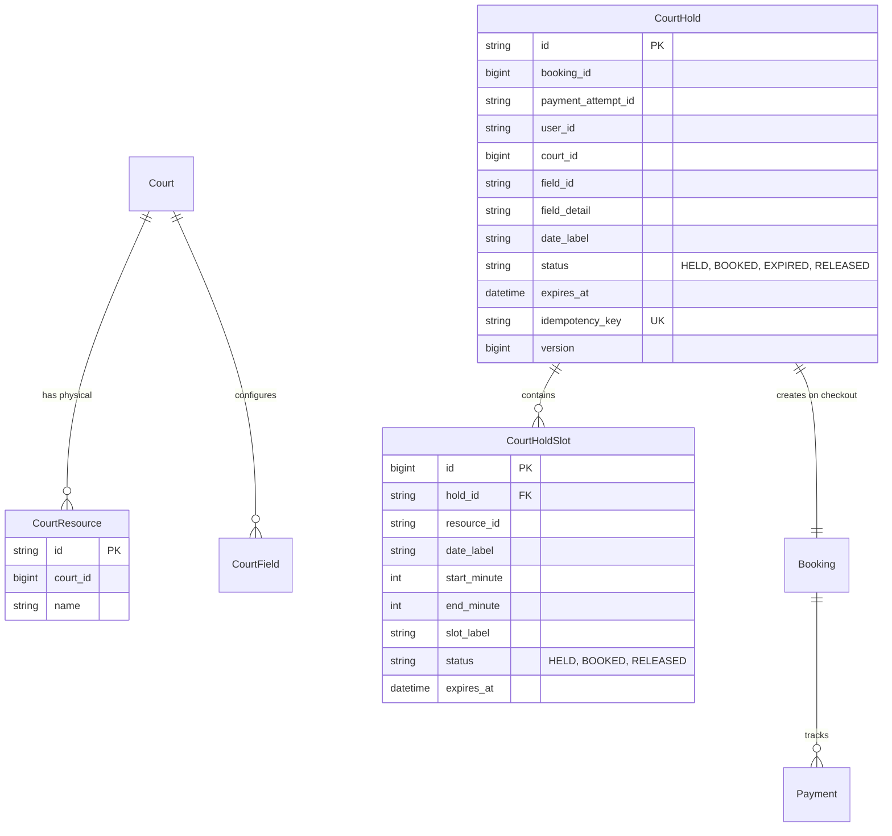
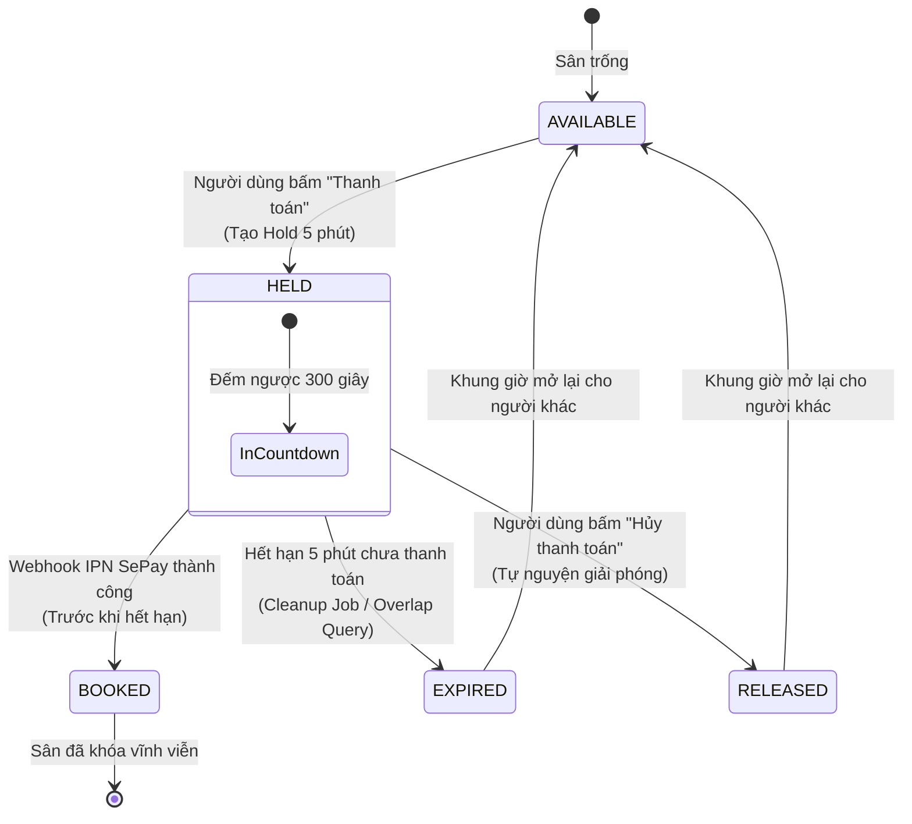

# Đặc Tả Kỹ Thuật & Hướng Dẫn Vận Hành: Cơ Chế Giữ Sân 5 Phút (EasySport)

Tài liệu này mô tả chi tiết thiết kế kiến trúc, cơ chế chống xung đột tranh chấp đồng thời (anti-double booking), mô hình tài nguyên sân vật lý, quy tắc nghiệp vụ giữ sân 5 phút và hướng dẫn kiểm thử 2 tài khoản trên hệ thống **EasySport**.

---

## 1. Mục Tiêu & Nguyên Tắc Nghiệp Vụ

### 1.1. Mục tiêu cốt lõi
1. **Nhiều người dùng cùng xem/chọn**: Khi sân còn trống, bất kỳ ai cũng có thể đồng thời xem và chọn cùng sân, cùng ngày, cùng khung giờ trên giao diện điện thoại. Thao tác chọn sân trên UI **không** giữ sân.
2. **Giành giữ sân nguyên tử (Atomic Hold)**: Giữ sân chỉ được thực hiện khi người dùng bấm nút **"Tiếp tục thanh toán"** hoặc **"Thanh toán qua SePay"**. Backend giành quyền giữ sân nguyên tử trong database; request nào ghi nhận trước tại database sẽ thành công trước.
3. **Thời hạn giữ sân đúng 5 phút**: Tính theo thời gian đồng hồ máy chủ/database từ thời điểm giành giữ thành công (`expiresAt = serverNow + 5 minutes`). Tuyệt đối không dựa vào đồng hồ điện thoại của client.
4. **Chống đặt chồng (Anti-Double Booking)**: Trong 5 phút giữ sân, không người dùng nào khác có thể bắt đầu thanh toán cho khung giờ chồng lấn trên cùng tài nguyên sân vật lý.
5. **Tự động giải phóng (Auto-Release)**: Nếu hết 5 phút mà chưa xác nhận thanh toán thành công, sân tự động trở lại trạng thái khả dụng cho người khác.
6. **Thanh toán thành công**: Khi cổng thanh toán SePay gửi Webhook IPN hợp lệ trong thời gian giữ sân, trạng thái được chuyển thành `BOOKED` (đặt sân thành công vĩnh viễn, cả với thanh toán đủ 100% lẫn đặt cọc 30%).
7. **Thanh toán muộn (Late Payment)**: Nếu tiền về sau khi thời gian 5 phút đã hết hạn, hệ thống chuyển sang trạng thái đối soát `REVIEW_REQUIRED` và không chiếm quyền sân nếu đã có người khác đặt.

---

## 2. Mô Hình Tài Nguyên & Xử Lý Tranh Chấp Sân Dùng Chung

### 2.1. Phân biệt Sân logic và Tài nguyên vật lý (CourtResource)
Trong thực tế, một sân bóng lớn (Sân 11 người) có thể chia thành hai sân nhỏ (Sân 7-1 và Sân 7-2) dùng chung cùng một mặt cỏ vật lý:
- **Tài nguyên vật lý (`court_resources`)**:
  - `RES_1_FIELD_1`: Nửa sân A (mặt cỏ 1)
  - `RES_1_FIELD_2`: Nửa sân B (mặt cỏ 2)
- **Ánh xạ sân logic (`court_fields.resource_keys`)**:
  - Sân 7 (Sân số 1) $\rightarrow$ chiếm `RES_1_FIELD_1`
  - Sân 7 (Sân số 2) $\rightarrow$ chiếm `RES_1_FIELD_2`
  - Sân 11 $\rightarrow$ chiếm cả `RES_1_FIELD_1` và `RES_1_FIELD_2`

Khi một người dùng đặt Sân 11, hệ thống sẽ khóa và kiểm tra xung đột trên **cả hai tài nguyên vật lý**. Nếu một người khác đang giữ Sân 7-1 ở cùng khung giờ, yêu cầu giữ Sân 11 sẽ bị từ chối ngay lập tức vì tài nguyên `RES_1_FIELD_1` đang bị chiếm giữ.

### 2.2. Công thức toán học phát hiện xung đột khung giờ
Hai khoảng thời gian $[start_A, end_A)$ và $[start_B, end_B)$ xảy ra xung đột khi và chỉ khi:
$$\text{start}_A < \text{end}_B \quad \text{AND} \quad \text{start}_B < \text{end}_A$$

**Hệ quả đối với các ca liền kề:**
- Ca 1: `07:00 - 08:30` ($420$ phút đến $510$ phút)
- Ca 2: `08:30 - 10:00` ($510$ phút đến $600$ phút)
- Kiểm tra: $420 < 600$ (Đúng) nhưng $510 < 510$ (Sai). Do đó hai ca liền kề **không xung đột**, cho phép hai người đặt nối tiếp nhau hoặc một người đặt ca đôi liên tục.

### 2.3. Khóa bi quan và Chống Deadlock (Pessimistic Locking & Lock Ordering)
Để đảm bảo tính nhất quán (ACID) tuyệt đối trên cơ sở dữ liệu MySQL InnoDB khi hàng trăm request cạnh tranh cùng mili-giây:
1. **Khóa ghi cấp dòng (`SELECT ... FOR UPDATE`)**: Khi bắt đầu giao dịch giữ sân, hệ thống thực hiện `SELECT ... FOR UPDATE` trên bảng `court_resources`.
2. **Sắp xếp thứ tự tài nguyên cố định (Ascending Lock Ordering)**:
   - Các mã tài nguyên vật lý luôn được sắp xếp theo thứ tự tăng dần trước khi thực thi lệnh khóa:
     ```java
     Collections.sort(sortedResourceIds);
     resourceRepository.lockResourcesForUpdate(courtId, sortedResourceIds);
     ```
   - Việc luôn khóa theo cùng một thứ tự đảm bảo loại trừ chu trình chờ đợi vòng tròn (Deadlock Cycle) theo nguyên lý Dijkstra Banker / Resource Hierarchy.
3. **Nguyên tử toàn bộ (All-or-Nothing Multi-Slot)**:
   - Khi người dùng chọn nhiều ca (ví dụ đặt 2 ca: 07:00-08:30 và 08:30-10:00), toàn bộ các ca và tài nguyên được thẩm định trong **cùng 1 Transaction**.
   - Nếu bất kỳ ca nào bị xung đột, Transaction rollback hoàn toàn; không có tình trạng giữ nửa vời một ca.

---

## 3. Kiến Trúc Dữ Liệu & Vòng Đời Trạng Thái (State Machine)

### 3.1. Sơ đồ thực thể quan hệ (ERD)



### 3.2. Vòng đời chuyển trạng thái Slot và Hold



---

## 4. Đặc Tả Chi Tiết API Backend

### 4.1. Khởi tạo giữ sân & Thanh toán (`POST /api/bookings/checkout`)
- **Mục đích**: Giành quyền giữ sân nguyên tử và tạo phiên thanh toán SePay.
- **Yêu cầu Headers**: `Content-Type: application/json`

#### Request Body
```json
{
  "userId": "user_12345",
  "courtId": 1,
  "courtName": "Sân bóng đá Chuyên Việt",
  "fieldId": "field_7_1",
  "fieldDetail": "Sân 7 - Sân 1",
  "dateLabel": "04/11/2026",
  "timeRange": "07:00 - 10:00",
  "slots": [
    "07:00 - 08:30",
    "08:30 - 10:00"
  ],
  "fullName": "Nguyễn Văn A",
  "phoneNumber": "0912345678",
  "paymentMethod": "QR_TRANSFER",
  "idempotencyKey": "9b1deb4d-3b7d-4bad-9bdd-2b0d7b3dcb6d"
}
```

#### Phản hồi Thành Công (`200 OK`)
```json
{
  "success": true,
  "holdId": "HOLD-6A7B8C9D",
  "bookingId": 105,
  "paymentToken": "PAY-TOKEN-UUID-1234",
  "checkoutUrl": "http://10.0.2.2:8080/payments/PAY-TOKEN-UUID-1234/checkout",
  "holdExpiresAt": "2026-11-04T17:15:00Z",
  "serverNow": "2026-11-04T17:10:00Z",
  "holdDurationSeconds": 300,
  "totalPrice": 300000.0,
  "depositAmount": 0.0,
  "message": "Giữ sân thành công. Vui lòng thanh toán trong vòng 5 phút."
}
```

#### Phản hồi Xung Đột (`409 Conflict`)
Khi một hoặc nhiều khung giờ đã có người khác giữ hoặc đặt:
```json
{
  "errorCode": "SLOT_UNAVAILABLE",
  "message": "Một hoặc nhiều khung giờ bạn chọn vừa có người khác giữ hoặc đã được đặt.",
  "conflictingSlots": [
    {
      "slot": "07:00 - 08:30",
      "status": "HELD",
      "expiresAt": "2026-11-04T17:14:32Z"
    }
  ],
  "serverNow": "2026-11-04T17:10:05Z"
}
```
*Lưu ý: Không tiết lộ bất kỳ thông tin cá nhân nào của người giữ trước.*

---

### 4.2. Tra cứu lịch trống theo thời gian thực (`GET /api/courts/{id}/availability`)
- **Query params**:
  - `date`: `dd/MM/yyyy` (ví dụ `04/11/2026`)
  - `field`: Tên loại sân (ví dụ `Sân 7 - Sân 1` hoặc `Sân 11`)
- **Phản hồi**:
```json
{
  "courtId": 1,
  "dateLabel": "04/11/2026",
  "fieldDetail": "Sân 7 - Sân 1",
  "serverNow": "2026-11-04T17:10:00Z",
  "slots": [
    {
      "slot": "07:00 - 08:30",
      "status": "HELD",
      "expiresAt": "2026-11-04T17:14:32Z"
    },
    {
      "slot": "08:30 - 10:00",
      "status": "AVAILABLE",
      "expiresAt": null
    },
    {
      "slot": "10:00 - 11:30",
      "status": "BOOKED",
      "expiresAt": null
    }
  ]
}
```

---

### 4.3. Tự nguyện giải phóng sân (`POST /api/bookings/hold/release`)
- **Mục đích**: Người dùng hủy thanh toán hoặc bấm nút Back rời màn hình thanh toán.
```json
{
  "holdId": "HOLD-6A7B8C9D",
  "userId": "user_12345"
}
```
- **Xử lý**: Hệ thống chuyển ngay `CourtHold.status = RELEASED` và các `CourtHoldSlot.status = RELEASED`, giải phóng tức thì khung giờ cho người khác.

---

## 5. Thiết Kế Giao Diện & Trải Nghiệm Người Dùng (Android)

### 5.1. Bảng quy chuẩn màu sắc trạng thái khung giờ
| Trạng thái | Màu nền / Viền | Nhãn text | Tương tác người dùng |
|---|---|---|---|
| **AVAILABLE (Trống)** | Xám nhạt (`#F1F5F9`) | Giờ bắt đầu - kết thúc | Cho phép chạm để chọn / bỏ chọn |
| **SELECTED (Đang chọn)** | Xanh dương thương hiệu (`#2B6CB0`) | Giờ bắt đầu - kết thúc | Cho phép chạm để bỏ chọn |
| **HELD (Đang giữ)** | Xám đậm (`#334155`) | "Đang giữ" | Không cho phép chọn (Disabled) |
| **BOOKED (Đã đặt)** | Xám đậm (`#334155`) | "Đã đặt" | Không cho phép chọn (Disabled) |

### 5.2. Luồng xử lý khi nhận HTTP 409 Conflict
1. Người dùng bấm **"Tiếp tục thanh toán"**.
2. App hiển thị loading indicator và gửi yêu cầu `POST /api/bookings/checkout`.
3. Nếu server trả về `409 Conflict`:
   - Dừng hiệu ứng loading, **không chuyển** sang trang thanh toán.
   - Hiển thị hộp thoại Dialog cảnh báo:
     > **Khung giờ không khả dụng**
     > Ca **07:00 - 08:30** vừa có người khác giữ hoặc đã được đặt. Vui lòng chọn khung giờ khác.
   - Tự động gọi lại API availability để cập nhật bảng màu các ca.
   - Tự động bỏ chọn (deselect) các ca bị xung đột và tính toán lại tổng tiền.

### 5.3. Đồng hồ đếm ngược 5 phút tại màn hình thanh toán
- Màn hình thanh toán `PaymentScreen` nhận `holdExpiresAt` và `serverNow` từ server.
- Sử dụng LaunchedEffect đếm ngược chính xác:
  ```kotlin
  val remainingSeconds = (expiresInstant.epochSecond - currentInstant.epochSecond).coerceAtLeast(0)
  ```
- Hiển thị định dạng `mm:ss` (ví dụ `04:58`).
- Khi hết thời gian:
  - Vô hiệu hóa nút thanh toán.
  - Hiển thị banner cảnh báo: "Phiên giữ sân 5 phút đã hết hạn. Vui lòng quay lại đặt sân mới."

---

## 6. Kịch Bản Kiểm Thử & Hướng Dẫn Test 2 Người Dùng

### 6.1. Ma trận 13 kịch bản Unit Test (Backend Suite)
Hệ thống EasySport đã hoàn thành và vượt qua 100% bộ 20 unit tests (bao gồm 13 kịch bản giữ sân chuyên biệt với `MutableTestClock`):

1. **TC1: Happy Path Đặt 1 ca trống**: Giữ thành công 5 phút, slot chuyển sang `HELD`.
2. **TC2: Hai ca liền kề không xung đột**: `07:00-08:30` và `08:30-10:00` giữ độc lập thành công.
3. **TC3: Xung đột chồng lấn thời gian**: Ca `07:00-08:30` từ chối ca `08:00-09:30` với mã 409.
4. **TC4: Đặt nhiều ca cùng lúc (Multi-slot All-or-Nothing)**: Chọn 3 ca mà 1 ca bị trùng $\rightarrow$ rollback toàn bộ 3 ca.
5. **TC5: Xung đột tài nguyên dùng chung (Sân 11 vs Sân 7)**: Sân 7-1 đang giữ $\rightarrow$ Sân 11 bị chặn vì chung mặt cỏ.
6. **TC6: Hết hạn 5 phút tự động khả dụng**: Tua đồng hồ lên 5 phút 1 giây $\rightarrow$ người thứ 2 giữ thành công ca đó.
7. **TC7: Tranh chấp đồng thời (Concurrency Pessimistic Lock)**: Chỉ 1 trong 2 luồng đồng thời thành công, luồng kia nhận 409.
8. **TC8: Tính bất biến lặp lại (Idempotency Key)**: Gọi checkout 2 lần cùng key trả về cùng Hold và URL, không cộng thêm 5 phút.
9. **TC9: Thanh toán trước hạn (IPN On-Time)**: Xác nhận IPN thành công trong 5 phút $\rightarrow$ Hold chuyển sang `BOOKED`.
10. **TC10: Thanh toán muộn (IPN Late)**: IPN về sau 5 phút $\rightarrow$ đánh dấu `REVIEW_REQUIRED`, không cướp slot người mới.
11. **TC11: Tự nguyện hủy (Voluntary Release)**: Gọi `releaseHold` $\rightarrow$ giải phóng tức thì không cần đợi 5 phút.
12. **TC12: Quét định kỳ (Scheduled Cleanup)**: Scheduler 30s giải phóng các bản ghi hết hạn mà không gây deadlock.
13. **TC13: Bảo mật thông tin lỗi 409**: DTO trả về danh sách slot xung đột nhưng không chứa tên/SĐT khách trước.

---

### 6.2. Hướng dẫn thực hành kiểm thử với 2 người dùng (User A & User B)

#### Chuẩn bị môi trường:
- Khởi động Backend: `mvn spring-boot:run` (hoặc chạy lớp `EasysportApplication`).
- Mở 2 cửa sổ hoặc 2 thiết bị:
  - Thiết bị 1 (hoặc Postman / App): Đăng nhập tài khoản **User A**.
  - Thiết bị 2 (hoặc Postman / App): Đăng nhập tài khoản **User B**.

#### Quy trình thực hiện:
| Bước | Thao tác User A | Thao tác User B | Kết quả mong đợi |
|---|---|---|---|
| **1** | Mở Sân bóng Chuyên Việt ngày mai, chọn ca `17:00 - 18:30`. | Mở cùng sân, cùng ngày, chọn cùng ca `17:00 - 18:30`. | Cả 2 đều thấy ca màu xanh dương (đang chọn trên UI). Chưa ai bị chặn vì chưa bấm thanh toán. |
| **2** | Bấm nút **"Tiếp tục thanh toán"**. | *Chưa thao tác.* | User A giành giữ sân thành công! Chuyển sang màn hình thanh toán SePay với đồng hồ đếm ngược `05:00`. |
| **3** | *Đang xem mã QR thanh toán.* | Bấm nút **"Tiếp tục thanh toán"**. | User B bị chặn ngay lập tức! Hệ thống hiển thị Dialog thông báo: *"Ca 17:00 - 18:30 vừa có người khác giữ. Vui lòng chọn khung giờ khác."* Ca chuyển sang xám đậm ("Đang giữ"). |
| **4** | Không thanh toán, chờ hết 5 phút (hoặc User A bấm nút Hủy / Back). | Sau khi hết 5 phút, User B chọn lại ca `17:00 - 18:30` và bấm **"Tiếp tục thanh toán"**. | Sân đã được giải phóng. User B giành quyền giữ sân thành công và tiến vào màn hình thanh toán SePay. |

---

## 7. Giới Hạn Kỹ Thuật & Khuyến Nghị Vận Hành
1. **Yêu cầu MySQL InnoDB**: Engine của database bắt buộc là `InnoDB` để hỗ trợ giao dịch ACID và khóa cấp dòng (`FOR UPDATE`).
2. **Đồng bộ thời gian máy chủ (NTP)**: Tất cả các node backend phải được đồng bộ thời gian qua giao thức NTP để đảm bảo tính toán thời gian hết hạn (`expiresAt`) chính xác tuyệt đối.
3. **Phân cụm Microservice (Distributed Setup)**:
   - Trong kiến trúc đa instance (Multi-instance load balancing), cơ chế khóa ghi `SELECT ... FOR UPDATE` trên MySQL tập trung đã đảm bảo an toàn 100% mà không bị ảnh hưởng bởi số lượng instance backend.
   - Nếu nâng cấp hệ thống quy mô lớn, có thể bổ sung Redlock (Redis) làm tầng bảo vệ đầu tiên trước khi chạm database.

