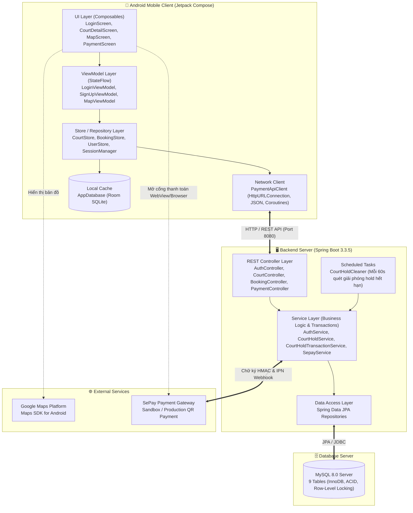
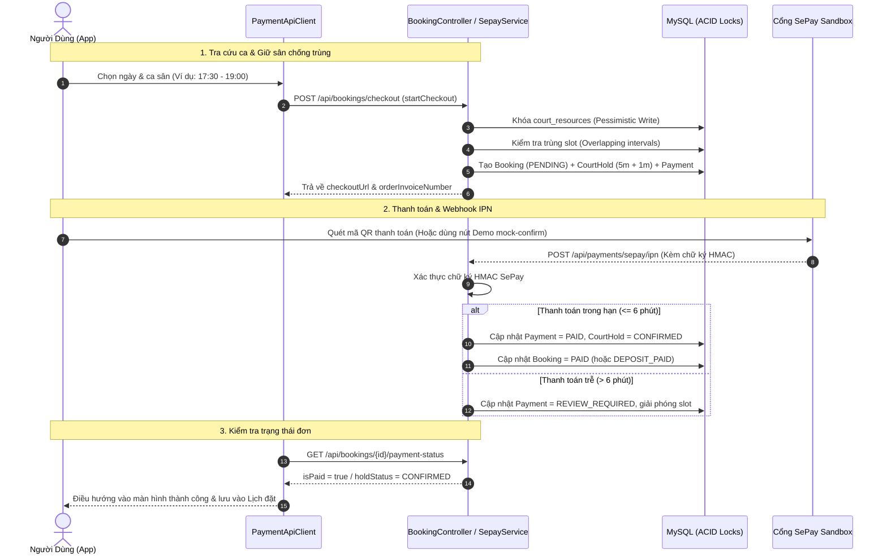

# 📋 Báo Cáo Kỹ Thuật & Cấu Trúc Toàn Diện Dự Án EasySport

> **Cập nhật:** 19/11/2026  
> **Ứng dụng:** EasySport (Đặt sân thể thao thông minh & Thanh toán tự động)  
> **Hệ sinh thái:** Android (Kotlin, Jetpack Compose, Material 3) + Backend (Java 17/25, Spring Boot 3.3.5) + Database (MySQL 8) + Payment Gateway (SePay Sandbox & Demo) + Maps (Google Maps SDK)

---

## 1. Tổng Quan Dự Án

### 1.1. Mục tiêu ứng dụng
EasySport là giải pháp ứng dụng di động kết hợp hệ thống backend toàn diện phục vụ việc tìm kiếm cơ sở thể thao (Bóng đá, Cầu lông, Pickleball...), tra cứu lịch trống theo thời gian thực, giữ chỗ tức thời chống đặt trùng (anti race-condition), và thanh toán tự động qua cổng thanh toán SePay (hỗ trợ chuyển khoản QR Code, thanh toán toàn phần hoặc đặt cọc 30%).

### 1.2. Phân loại trạng thái tính năng hiện tại

| Nhóm chức năng | Trạng thái kỹ thuật | Mô tả chi tiết |
| :--- | :---: | :--- |
| **Đăng ký tài khoản** | ✅ Kết nối Backend thật | Kiểm tra trùng Email/SĐT, băm mật khẩu chuẩn PBKDF2 with HMAC-SHA256, tự động cấp JWT/Session Token. |
| **Đăng nhập & Quản lý phiên** | ✅ Kết nối Backend thật | Hỗ trợ đăng nhập linh hoạt bằng Email hoặc Số điện thoại. Lưu phiên bảo mật trong `SessionManager` (EncryptedSharedPreferences/Room). |
| **Danh sách sân & Bộ lọc** | ✅ Kết nối Backend thật + Cache | Tải danh sách sân từ REST API `/api/courts`. Cache ngoại tuyến qua Room SQLite (`CourtDao`) để hiển thị khi mất mạng. |
| **Bản đồ số & Định vị GPS** | ✅ Hoạt động đầy đủ | Tích hợp Google Maps SDK, hiển thị Marker vị trí sân, tính khoảng cách thực tế (Haversine Formula) theo vị trí người dùng. |
| **Tra cứu ca trống theo ngày** | ✅ Thời gian thực (Realtime) | Gọi `/api/courts/{id}/availability`, tự động nhận diện 3 trạng thái: `AVAILABLE` (trống), `HELD` (đang có người giữ/chờ thanh toán), `BOOKED` (đã đặt). |
| **Giữ chỗ chống đặt trùng** | ✅ Nguyên tử (ACID Transaction) | Giữ sân với thời hạn **5 phút thanh toán + 1 phút xác minh** (tổng 6 phút). Khóa bi quan (Pessimistic Lock) trên mặt sân vật lý (`court_resources`). |
| **Thanh toán SePay & Đặt cọc** | ✅ Hoạt động đầy đủ | Sinh link thanh toán SePay có chữ ký số HMAC-SHA256, hỗ trợ trả 100% hoặc cọc 30% (`CASH_ON_SITE`). Tích hợp IPN Webhook và trang Demo giả lập (`mock-confirm`). |
| **Tra cứu & Quản lý lịch đặt** | ✅ Kết nối Backend thật | Đồng bộ danh sách lịch từ `/api/bookings/my`, tra cứu trạng thái thanh toán `/api/bookings/{id}/payment-status`, hủy lịch hoàn giữ chỗ `/api/bookings/{id}/cancel`. |
| **Màn hình Thông báo** | 🟡 Dữ liệu mẫu (Sample Data) | Sử dụng danh sách tĩnh `SAMPLE_NOTIFICATIONS` trong `NotificationScreen.kt` để hiển thị UI giao diện thông báo do chưa xây dựng microservice Push Notification trên backend. |
| **Đánh giá sân & Chat chủ sân** | ⚪ Chưa triển khai | Đang chuẩn bị mô hình dữ liệu trong database, chưa kết nối API. |

---

## 2. Kiến Trúc Hệ Thống

### 2.1. Sơ đồ kiến trúc tổng thể (Mermaid)



### 2.2. Cơ chế phối hợp giữa các tầng
- **Tầng giao diện (UI Composables):** Xây dựng 100% bằng Jetpack Compose. Các Composable phức tạp (như `LoginScreen`, `SignUpScreen`, `MapScreen`) ủy quyền trạng thái cho `ViewModel` thông qua `StateFlow`. Ở một số màn hình tập trung thao tác điều hướng (như `CourtDetailScreen`, `PaymentScreen`), Composable trực tiếp kích hoạt tác vụ qua `PaymentApiClient` và cập nhật các State Flow dùng chung trong `UserStore`, `CourtStore`, `BookingStore`.
- **Tầng dữ liệu Client:** `PaymentApiClient` đảm nhiệm toàn bộ giao tiếp mạng HTTP (xác thực, tải danh sách sân, kiểm tra ca trống, tạo phiên giữ chỗ, kiểm tra thanh toán). Phiên đăng nhập được quản lý tập trung qua `SessionManager`. Khi thiết bị mất mạng, `CourtStore` tự động nạp dữ liệu từ bộ nhớ đệm `AppDatabase` (Room SQLite).
- **Tầng Backend:** Xây dựng trên nền tảng Spring Boot 3. Toàn bộ logic giao dịch quan trọng (đặt sân, thanh toán, hủy lịch) được bọc trong `@Transactional` với mức cô lập `READ_COMMITTED` và khóa bi quan (`PESSIMISTIC_WRITE`) trên các hàng cơ sở dữ liệu để bảo đảm tính toàn vẹn dữ liệu tuyệt đối.

---

## 3. Cấu Trúc Mã Nguồn

### 3.1. Cây thư mục rút gọn
```
PTUD_mobileapp/
├── app/                                    <- Ứng dụng Android (Kotlin)
│   ├── build.gradle.kts                    <- Cấu hình SDK 37, Build BuildConfig & ManifestPlaceholders
│   └── src/
│       ├── main/
│       │   ├── AndroidManifest.xml         <- Cấp quyền Internet, Location, Cleartext Traffic
│       │   └── java/com/example/easysport/
│       │       ├── MainActivity.kt         <- Khởi tạo AppNavHost & kiểm tra phiên đăng nhập
│       │       ├── data/
│       │       │   ├── local/              <- Room SQLite: AppDatabase, DAO, Entity, SessionManager
│       │       │   ├── model/              <- Domain Models: Court, Booking, User, TimeSlot...
│       │       │   ├── remote/
│       │       │   │   └── PaymentApiClient.kt  <- Client HTTP đa năng (Auth, Court, Booking, Payment)
│       │       │   └── repository/         <- NetworkAuthRepository, CourtStore, BookingStore, SampleData
│       │       ├── location/               <- Trình trợ giúp GPS & quyền vị trí
│       │       ├── ui/
│       │       │   ├── account/            <- Màn hình Hồ sơ & Đổi thông tin người dùng
│       │       │   ├── booking/            <- CourtSearchScreen, CourtDetailScreen, PaymentScreen...
│       │       │   ├── home/               <- HomeScreen, NotificationScreen
│       │       │   ├── login/              <- LoginScreen, LoginViewModel
│       │       │   ├── map/                <- MapScreen, MapViewModel
│       │       │   ├── navigation/         <- AppNavHost (Quản lý Route & Stack điều hướng)
│       │       │   └── signup/             <- SignUpScreens (2 bước), SignUpViewModel
│       │       └── util/                   <- Tiện ích tính khoảng cách sân (Haversine)
│       └── test/                           <- Unit Test: LoginViewModelTest, SignUpViewModelTest...
│
├── backend/                                <- Máy chủ Spring Boot (Java 17/25)
│   ├── pom.xml                             <- Khai báo Spring Boot 3.3.5, Hibernate 6, MySQL Driver
│   ├── run.bat                             <- Script khởi động backend độc lập
│   └── src/
│       ├── main/
│       │   ├── java/com/easysport/
│       │   │   ├── EasySportApplication.java  <- Điểm khởi chạy Spring Boot & Scheduler
│       │   │   ├── config/                 <- SepayConfig, CorsConfig, TimeConfig, DataInitializer
│       │   │   ├── controller/             <- AuthController, CourtController, BookingController, PaymentController
│       │   │   ├── dto/                    <- DTO Request & Response
│       │   │   ├── entity/                 <- 9 JPA Entities tương ứng 9 bảng MySQL
│       │   │   ├── repository/             <- Spring Data JPA Repositories (Locking queries)
│       │   │   ├── service/                <- AuthService, CourtHoldService, CourtHoldTransactionService, SepayService
│       │   │   └── util/                   <- PasswordHasher (PBKDF2)
│       │   └── resources/
│       │       └── application.properties  <- Cấu hình JDBC, JPA DDL, SePay properties
│       └── test/                           <- 37 JUnit Tests: CourtHoldServiceTest, SepayServiceTest...
│
├── database/                               <- Cơ sở dữ liệu
│   ├── easysport_mysql.sql                 <- Schema DDL 9 bảng & dữ liệu nạp ban đầu
│   └── migration_v2_sessions_and_hold_deadlines.sql
├── docs/                                   <- Tài liệu kỹ thuật chi tiết
│   ├── COURT_HOLD_SPECIFICATION.md         <- Đặc tả kỹ thuật giữ sân 5m+1m & chống deadlock
│   ├── GOOGLE_MAPS_SETUP.md                <- Hướng dẫn cấp Key Google Maps
│   └── SEPAY_SANDBOX_SETUP.md              <- Hướng dẫn tích hợp cổng SePay
└── run-backend.bat                         <- Script 1-click chạy backend cho Windows
```

### 3.2. Bảng các file trọng yếu và trách nhiệm

| Tệp tin | Vị trí | Trách nhiệm chính |
| :--- | :--- | :--- |
| **`PaymentApiClient.kt`** | `app/.../data/remote/` | **Trung tâm kết nối mạng Android:** Xử lý toàn bộ REST API: Đăng nhập/Đăng ký, lấy danh sách sân, tra cứu ca trống, tạo đơn giữ chỗ, lấy URL SePay, kiểm tra trạng thái thanh toán và tự động thích ứng `127.0.0.1` (máy thật + `adb reverse`) hoặc `10.0.2.2` (máy ảo Emulator). |
| **`AppNavHost.kt`** | `app/.../ui/navigation/` | Quản lý đồ thị điều hướng Jetpack Compose, truyền tham số giữa các màn hình, kiểm tra phiên đăng nhập và định tuyến tự động. |
| **`CourtStore.kt`** | `app/.../data/repository/` | Quản lý State danh sách sân, tìm kiếm, lọc theo môn thể thao, đồng bộ dữ liệu mạng và tự động fallback về Room cache khi mất kết nối. |
| **`CourtHoldTransactionService.java`** | `backend/.../service/` | Thực thi các giao dịch ACID quan trọng: phân rã mặt sân vật lý, khóa tài nguyên chống deadlock theo thứ tự cố định, kiểm tra xung đột khung giờ và giữ chỗ. |
| **`SepayService.java`** | `backend/.../service/` | Tạo chữ ký HMAC-SHA256 gửi sang SePay Sandbox, tiếp nhận và xác thực Webhook IPN, xử lý thanh toán trễ, sinh trang demo giả lập thanh toán (`mock-confirm`). |
| **`PasswordHasher.java`** | `backend/.../util/` | Sinh muối (Salt 16 bytes) và băm mật khẩu PBKDF2 (10,000 vòng) chuẩn bảo mật OWASP; hỗ trợ tự động nâng cấp mật khẩu cũ. |

---

## 4. Mô Hình Dữ Liệu

### 4.1. Chi tiết 9 bảng trong MySQL (`easysport`)

1. **`users`**: Quản lý tài khoản (ID, email, số điện thoại, mật khẩu băm `password_hash`, họ tên, ngày sinh, vai trò `USER`/`OWNER`, trạng thái khóa `is_locked`).
2. **`user_sessions`**: Quản lý phiên token đăng nhập (token `t_...`, `user_id`, thời gian hết hạn `expires_at`).
3. **`courts`**: Thông tin cụm sân thể thao (tên, địa chỉ, tọa độ `latitude`/`longitude`, loại thể thao `sport_type`, trong nhà `indoor`, bảng giá ca `session_prices_json`, tiện ích `amenities_json`).
4. **`court_fields`**: Các sân đấu con logic mà khách hàng nhìn thấy để chọn (ví dụ: "Sân 5A", "Sân 5B", "Sân 7 người", `field_type`, `resource_keys`).
5. **`court_resources`**: **Tài nguyên mặt sân vật lý** phục vụ khóa bi quan chống xung đột khi một sân lớn có thể chia thành nhiều sân nhỏ (ví dụ: Sân 7 dùng chung mặt sân `g1` và `g2` của hai Sân 5).
6. **`bookings`**: Đơn đặt sân hoàn chỉnh (mã đơn `b_...`, mã sân, chi tiết sân, ngày đặt, khung giờ, tổng tiền, tiền cọc `deposit_amount`, tiền còn lại `remaining_amount`, hình thức `payment_method`, trạng thái `status`).
7. **`payments`**: Bản ghi thanh toán (mã `pay_...`, mã đơn `booking_id`, mã hóa đơn SePay `order_invoice_number`, token thanh toán, số tiền đã xác nhận `confirmed_amount`, thời điểm xác nhận `confirmed_at`, trạng thái `PAID`/`REVIEW_REQUIRED`).
8. **`court_holds`**: Phiên giữ sân tạm thời (thời điểm hết hạn giữ chỗ `expires_at`, hạn chót thanh toán `payment_deadline` = 5 phút, hạn chót xác minh `verification_deadline` = 6 phút, phiên bản `@Version` kiểm soát xung đột lạc quan).
9. **`court_hold_slots`**: Bản ghi chi tiết từng khung giờ và từng tài nguyên vật lý cụ thể được chiếm giữ (`start_minute`, `end_minute`, trạng thái `HELD`/`BOOKED`/`EXPIRED`).

### 4.2. Khác biệt giữa SQL Schema và Entity Java
- **Thuộc tính kiểm soát phiên bản:** Bảng `court_holds` trong SQL có cột `version INT DEFAULT 0`, được ánh xạ tới `@Version private Integer version` trong `CourtHold.java` để bảo vệ chống ghi đè đồng thời ở tầng Hibernate.
- **Ánh xạ cột khóa tài khoản:** SQL lưu cột `is_locked BOOLEAN`, Java Entity ánh xạ là `@Column(name = "is_locked") private Boolean locked`.
- **Cột lịch sử tương thích:** Bảng `bookings` có cột cũ `hold_expires_at` (DATETIME NULL), entity Java vẫn giữ trường này để tương thích ngược nhưng toàn bộ nghiệp vụ kiểm tra hạn chót hiện đại đã được chuyển hẳn sang bảng `court_holds` (`verification_deadline`).

### 4.3. Phạm vi Cache Room & Lưu phiên trên Android
- **Lưu phiên đăng nhập:** Triển khai trong `SessionManager.kt`, lưu Token và thông tin User (`id`, `email`, `name`, `phone`) vào `SharedPreferences` (có thể mã hóa). Khi mở app, `MainActivity` tự động kiểm tra token hợp lệ để bypass màn hình đăng nhập.
- **Cache dữ liệu sân:** `AppDatabase` (Room SQLite phiên bản 2) lưu trữ các bảng `courts`, `court_fields` qua `CourtDao`. `CourtStore` luôn ưu tiên gọi API trước, nếu phát hiện mất mạng thì đọc từ SQLite nạp lên UI giúp người dùng vẫn xem được thông tin sân đã duyệt.

---

## 5. Quy Trình Nghiệp Vụ Chính



### 5.1. Luồng Giữ sân 5 phút + 1 phút xác minh (5m + 1m Policy)
1. **Giai đoạn thanh toán (0 - 5 phút):** Khung giờ được đánh dấu `HELD`. Người dùng khác tra cứu sẽ thấy trạng thái đang được giữ.
2. **Giai đoạn gia hạn xác minh mạng (phút 5 - 6):** Nếu sau 5 phút giao dịch chưa hoàn tất trên app nhưng SePay đang xử lý giao dịch ngân hàng, hệ thống cho thêm 1 phút đệm (verification deadline). Trong phút thứ 6 này, sân vẫn được bảo vệ không cho người khác tranh chấp.
3. **Quá hạn 6 phút (Hết hạn):** Tác vụ nền định kỳ `cleanExpiredHolds` (chạy mỗi 60 giây) sẽ quét các hold quá hạn và tự động giải phóng tài nguyên. Nếu tiền chuyển đến sau thời điểm này, backend chuyển đơn sang trạng thái `REVIEW_REQUIRED` (cần nhân viên đối soát hoàn tiền) và **tuyệt đối không chiếm lại sân** nếu sân đã có khách mới đặt.

---

## 6. Hướng Dẫn Vận Hành & Khởi Chạy

### 6.1. Khởi động Cơ sở dữ liệu MySQL
- Dịch vụ MySQL trên máy (`MySQL267`) cần được chạy trên cổng mặc định `3306`.
- Tên cơ sở dữ liệu: `easysport`.
- Đảm bảo đã import đầy đủ cấu trúc và dữ liệu mẫu từ tệp [easysport_mysql.sql](file:///d:/DaiHoc/PTUD_mobileapp/database/easysport_mysql.sql).

### 6.2. Khởi động Backend Spring Boot
- Mở thư mục dự án và nhấp đúp chạy tệp [run-backend.bat](file:///d:/DaiHoc/PTUD_mobileapp/run-backend.bat) (script đã được cấu hình trỏ đúng `JAVA_HOME=D:\Java\jdk-25` và Maven).
- Hoặc chạy qua PowerShell:
  ```powershell
  $env:JAVA_HOME="D:\Java\jdk-25"
  cd backend
  & "C:\Users\HP\Downloads\apache-maven-3.10.0-bin\apache-maven-3.10.0\bin\mvn.cmd" spring-boot:run
  ```
- Kiểm tra backend sẵn sàng tại: `http://localhost:8080/api/courts`.

### 6.3. Khởi động Ứng dụng Android
- **Nếu chạy trên Máy ảo Android Studio (Emulator):**
  - App tự động trỏ về `http://10.0.2.2:8080`.
- **Nếu chạy trên Thiết bị thật (Samsung Galaxy S10 / Thiết bị qua cáp USB hoặc Wi-Fi):**
  - Mở PowerShell và kích hoạt chuyển tiếp cổng:
    ```powershell
    & "D:\SDK\platform-tools\adb.exe" reverse tcp:8080 tcp:8080
    ```
  - App đã được bổ sung logic tự nhận diện thiết bị thật để gọi `http://127.0.0.1:8080`, mọi request sẽ chạy xuyên qua cổng `adb reverse` vào máy chủ host.

### 6.4. Tài khoản thử nghiệm có sẵn

| Tên hiển thị | Vai trò | Email đăng nhập | SĐT đăng nhập | Mật khẩu |
| :--- | :--- | :--- | :--- | :--- |
| **Nguyễn Văn A** | `USER` (Khách đặt sân) | `nguyenvana@gmail.com` | `0901234567` | `123456` |
| **Trần Minh Quân** | `USER` (Khách đặt sân) | `quan@gmail.com` | `0912345678` | `Password1` |
| **Trần Văn B** | `OWNER` (Chủ sân) | `tranvanb@gmail.com` | `0987654321` | `123456` |

---

## 7. Báo Cáo Rà Soát & Dọn Dẹp Mã Nguồn

### 7.1. Các mục đã xóa và bằng chứng xác minh

| STT | Tệp tin / Mã nguồn đã xóa | Loại bỏ | Bằng chứng xác minh |
| :---: | :--- | :--- | :--- |
| **1** | `FakeAuthRepository` trong `AuthRepository.kt` | Class & Imports | Đăng nhập/đăng ký hiện đã dùng `NetworkAuthRepository.instance`. Unit tests tự khai báo `FakeTestAuthRepository`. Các import trong `LoginViewModel` và `SignUpViewModel` là dư thừa. |
| **2** | `RoomAuthRepository.kt` | Toàn bộ tệp | Không có bất kỳ nơi nào trong dự án khởi tạo hay gọi class này. |
| **3** | `RoomBookingRepository.kt` | Toàn bộ tệp | Không có bất kỳ nơi nào trong dự án khởi tạo hay gọi class này. |
| **4** | Tham số `slots = SampleData.timeSlots` trong `CourtDetailScreen.kt` | Tham số hàm | Thân hàm `CourtDetailScreen` sử dụng hoàn toàn `liveSlots` từ API realtime `PaymentApiClient.getCourtAvailability`. Cả `AppNavHost` và `@Preview` đều không truyền tham số này. |
| **5** | Import `SampleData` dư thừa | 4 file UI | Các file `CourtSearchScreen.kt`, `HomeScreen.kt`, `MapViewModel.kt`, `AppNavHost.kt` chứa import `SampleData` nhưng không hề dùng trong mã nguồn. |
| **6** | `sundayBooking`, `sundayLabel()`, `bookingDates` trong `SampleData.kt` | Thuộc tính & hàm | 0 lượt tham chiếu. Lịch trên Home hiện được `AppNavHost` tính toán trực tiếp từ `BookingStore.bookings`. |
| **7** | `findActiveBookingsForSlot(...)` trong `BookingRepository.java` | Phương thức Query | 0 nơi gọi trong backend. Cơ chế giữ slot đã được chuyển hẳn sang bảng `court_hold_slots`. |
| **8** | `findActiveHoldsForCourt(...)` trong `CourtHoldRepository.java` | Phương thức Query | 0 nơi gọi trong backend. Phương thức tra cứu lịch trống thực tế gọi qua `courtHoldSlotRepository.findActiveSlotsForCourt`. |
| **9** | `existsByOrderInvoiceNumber(...)` trong `PaymentRepository.java` | Phương thức JPA | 0 nơi gọi. Toàn bộ logic tra cứu thanh toán dùng `findByOrderInvoiceNumber` hoặc `findByOrderInvoiceNumberWithLock`. |
| **10**| `confirmHold(...)` trong `CourtHoldService.java` & `confirmHoldTransaction` trong `CourtHoldTransactionService.java` | Phương thức Service | 0 nơi gọi. Việc xác nhận thanh toán được thực thi tập trung và toàn vẹn tại `SepayService.processIpn` và `SepayService.mockConfirm`. |

### 7.2. Các mục quyết định GIỮ LẠI và lý do

1. **`SepayConfig.getQueryApiUrl()`**: Giữ lại vì là phương thức getter của thuộc tính Spring `@Configuration` (`sepay.query-api-url`) đã được cấu hình trong `application.properties` và tài liệu kỹ thuật [SEPAY_SANDBOX_SETUP.md](file:///d:/DaiHoc/PTUD_mobileapp/docs/SEPAY_SANDBOX_SETUP.md).
2. **`CourtHoldTransactionService.acquireHoldTransaction`**: Giữ lại vì đây là lõi xử lý được gọi trực tiếp từ `BookingController.checkout` (`/api/bookings/checkout`).
3. **Các bảng và DAO của Room SQLite (`AppDatabase`, `UserEntity`, `BookingEntity`, `CourtEntity`, `CourtDao`)**: Giữ lại toàn bộ schema Room phiên bản 2 vì `CourtStore` vẫn dùng `CourtDao` để lưu và đọc cache sân khi thiết bị mất mạng; việc sửa schema Room sẽ gây lỗi tương thích cho các bản cài đặt hiện hành nếu thiếu migration.
4. **`SAMPLE_NOTIFICATIONS` trong `NotificationScreen.kt`**: Giữ lại vì màn hình Thông báo hiện vẫn đang dùng danh sách này để kết xuất UI.
5. **Dữ liệu `SampleData.courts`, `SampleData.timeSlots`, `SampleData.upcomingBooking`**: Giữ lại để phục vụ hiển thị `@Preview` trong Android Studio Compose Preview.

### 7.3. Các vấn đề kỹ thuật phát hiện cần xử lý trước khi phát hành (Production Checklist)

1. **Cô lập endpoint `/payments/{token}/mock-confirm` theo môi trường (Độ ưu tiên: CAO):**
   - *Hiện trạng:* Endpoint `POST /payments/{token}/mock-confirm` hiện mở công khai để phục vụ demo local không cần SePay Sandbox.
   - *Rủi ro:* Nếu đưa lên môi trường Production, người dùng có thể kích hoạt endpoint này để tự xác nhận thanh toán đơn hàng mà không chuyển tiền thật.
   - *Kiến nghị:* Bổ sung `@Profile({"dev", "test"})` hoặc kiểm tra điều kiện `if (!sepayConfig.isConfigured())` để vô hiệu hóa hoàn toàn endpoint này khi chạy môi trường thật.
2. **Quản lý biến môi trường bảo mật (Độ ưu tiên: TRUNG BÌNH):**
   - Khi triển khai lên server thật, các giá trị `sepay.merchant-id`, `sepay.secret-key`, `sepay.ipn-secret` và `maps.api.key` cần được inject qua Docker Environment Variables hoặc hệ thống Secret Manager, không lưu trực tiếp vào mã nguồn.

### 7.4. Kết quả kiểm thử sau dọn dẹp

- **Kiểm thử Backend (`mvn test`):**
  - Tổng số test: **37/37 PASSED** (0 Failures, 0 Errors, 0 Skipped).
  - Bao gồm: `AuthServiceTest` (6 tests), `BookingRulesTest` (6 tests), `CourtHoldServiceTest` (13 tests), `SepayServiceTest` (12 tests).
  - Kết quả: **`BUILD SUCCESS`** (thời gian chạy: 20.99s).
- **Kiểm thử Android Client (`.\gradlew.bat :app:assembleDebug :app:testDebugUnitTest`):**
  - Biên dịch và đóng gói APK Debug: **Thành công** (`:app:assembleDebug`).
  - Unit tests máy khách Android: **Thành công** (`:app:testDebugUnitTest`).
  - Kết quả: **`BUILD SUCCESSFUL`** (thời gian chạy: 46s, 47 actionable tasks).
